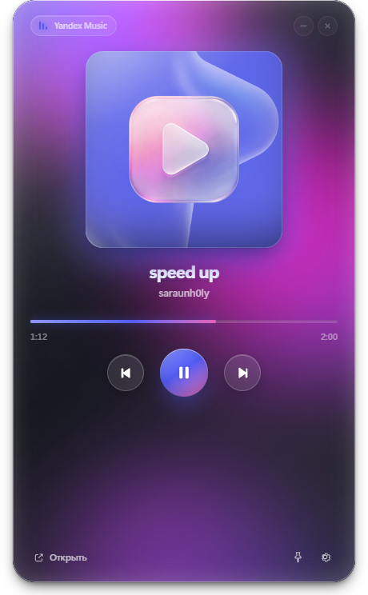
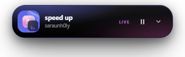
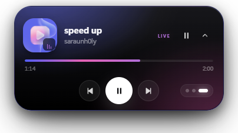
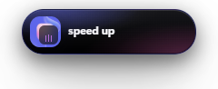

# Liquid Glass Music

Музыкальный виджет в стиле **Liquid Glass / Glassmorphism** для Windows.
Показывает текущий трек из **Яндекс Музыки** (или любого другого плеера),
умеет ставить паузу, переключать треки и перематывать — **без токенов, логинов
и API-ключей**.



### 🏝️ Dynamic Island

Плавающая плашка-остров (всегда поверх окон) в трёх размерах — клик по острову
или кнопка-шеврон переключает компактный → расширенный → развёрнутый режим:

| Расширенный | Развёрнутый | Компактный |
|---|---|---|
|  |  |  |

В развёрнутом режиме — прогресс-бар, перемотка, prev/next и кнопки размера.
Включается/выключается в настройках виджета.

> Скриншоты сняты на нейтральном тестовом фоне.

---

## ⬇️ Скачать готовый exe

Самый быстрый способ: [Releases](https://github.com/danioi21/liquid-glass-music/releases)
→ скачайте **`Liquid Glass Music.exe`** (~125 МБ) → запустите. Устанавливать
ничего не нужно, Node.js и .NET не требуются.

---

## 🚀 Быстрый запуск (самый простой способ)

1. **Дважды кликните `start.bat`** в папке проекта.
2. Первый запуск занимает 2–5 минут: лаунчер сам скачает portable Node.js
   и Electron (нужен интернет, около 150 МБ).
3. Готово. Появится окно виджета.

Дальше:

1. Откройте **Яндекс Музыку** (приложение или веб-плеер в браузере).
2. Включите любой трек.
3. Виджет подхватит его автоматически: обложка, название, артист, прогресс,
   а цвета «жидкого стекла» соберутся из обложки.

> Пока ничего не играет, виджет показывает **демо-режим**: 3 трека и сочные
> палитры меняются каждые 10 секунд. Как только музыка заиграет — виджет
> переключится на неё.

### Если Node.js уже установлен

```bash
npm install
npm start
```

Режим разработки (с DevTools):

```bash
npm run dev
```

---

## ✨ Что умеет

- **Dynamic Island** — плавающая «островная» плашка в стиле iPhone 14 Pro:
  отдельное окно поверх всех окон, три размера (компактный / расширенный /
  развёрнутый), обложка, прогресс и управление воспроизведением.
- **Настоящее жидкое стекло**: прозрачное окно без рамки, `backdrop-filter: blur(30px) saturate(180%)`,
  скругление 28 px, внутренняя светящаяся рамка, глубокая тень.
- **Живой фон**: три цветных пятна с плавной CSS-анимацией; цвета перетекают
  за 1.4 секунды через зарегистрированные `@property`-переменные.
- **Цвета из обложки**: палитра извлекается на canvas (доминирующие сочные
  оттенки), акцент применяется к прогресс-бару, кнопке Play и свечению обложки.
- **Реальная интеграция с Яндекс Музыкой** через системную медиасессию Windows
  (SMTC): трек, артист, обложка, позиция, длительность, play/pause,
  следующий/предыдущий трек, перемотка.
- **Работает с любым плеером** в режиме «Авто»: Яндекс Музыка, Spotify,
  браузер (Chrome/Edge/Firefox), VLC, AIMP и т. д.
- **Демо-режим** с автоматической сменой трека каждые 10 секунд.
- **Две темы**: тёмное и светлое стекло.
- **Поверх всех окон** — закрепите виджет кнопкой-булавкой.
- **Настройки** с выбором источника, темы, закрепления и переподключением.
- **Горячие клавиши**: `Space` — пауза/играть, `←/→` — перемотка на 5 сек
  (`Shift` — 15 сек), `Esc` — закрыть настройки. Ползунок прогресса можно
  тянуть мышью.

---

## 🎧 Как подключить Яндекс Музыку

Никакой авторизации не нужно. Виджет читает **System Media Transport Controls** —
ту самую медиасессию, которую Windows показывает в всплывающем окне громкости.

1. Установите [десктопное приложение Яндекс Музыки](https://music.yandex.ru/download/)
   или откройте веб-плеер в Chrome/Edge.
2. Запустите воспроизведение.
3. В виджете появится источник «Яндекс Музыка».

Если Яндекс Музыка была открыта, но стояла на паузе, при первом запуске
виджет может показать демо. Это специально: так вы сразу видите анимацию.
Нажмите Play в Яндекс Музыке — и виджет переключится на реальный трек.
После первого воспроизведения пауза уже отображается как пауза, а не демо.

**Почему не официальный API Яндекса?** У публичного API нет метода «что играет
сейчас», а неофициальный требует OAuth-токен и всё равно не даёт состояние
плеера. SMTC — штатный системный способ, он работает с любым плеером и не
требует хранить секреты.

---

## 🖥️ Требования

| Компонент | Требование |
|---|---|
| ОС | Windows 10 2004+ или Windows 11, x64 |
| Яндекс Музыка | приложение или веб-плеер в браузере |
| Node.js | не нужен — лаунчер скачает portable |
| .NET | не нужен — мост собран self-contained |
| Интернет | только при первом запуске (скачивание Node/Electron) |

На macOS приложение тоже запускается (там включается нативный `vibrancy`),
но SMTC — только Windows, поэтому на macOS/Linux доступен демо-режим.

---

## ⚙️ Настройки

- **Источник**
  - `Авто` — приоритет у Яндекс Музыки, иначе играющий плеер, иначе демо.
  - `Яндекс` — показывать только Яндекс Музыку (или демо, если её нет).
  - `Демо` — принудительно 3 демо-трека со сменой каждые 10 секунд.
- **Оформление** — тёмное или светлое стекло.
- **Поверх всех окон** — закрепить окно.
- **Открыть Яндекс Музыку** — запускает установленное приложение или веб-плеер.
- **Переподключить медиасессию** — перезапускает мост, если трек «потерялся».

---

## 🧠 Как это устроено

```
Electron (main.js)
  ├─ прозрачное окно без рамки, всегда поверх (опционально)
  ├─ spawn SmtcBridge.exe  ←  .NET-мост к Windows SMTC
  │     ├─ читает сессии: title, artist, album, status, position, duration
  │     ├─ вытаскивает обложку (PNG/JPEG) и кэширует её
  │     └─ принимает команды через JSON-файлы: playpause / next / prev / seek
  └─ IPC → renderer (src/app.js)
        ├─ рисует трек, прогресс, обложку
        ├─ извлекает палитру из обложки (canvas)
        ├─ плавно меняет цвета трёх blob'ов
        └─ демо-режим, настройки, темы
```

- Окно: `transparent: true`, `frame: false`, `backgroundColor: '#00000000'`.
  На macOS дополнительно `vibrancy: 'under-window'`.
- Стекло: `.glass` с `backdrop-filter: blur(30px) saturate(180%)` поверх
  цветных пятен; сверху — зерно, блик и внутренняя рамка.
- Цвета: `@property --b1a …` типа `<color>` — Chromium умеет интерполировать
  их, поэтому переход действительно плавный, а не мгновенная смена градиента.
- Обложка: реальная из медиасессии; если её нет — генерируется SVG-градиент
  по названию трека.
- Безопасность: `contextIsolation`, `sandbox`, CSP, никаких внешних скриптов.

---

## 📁 Структура проекта

```
liquid-glass-music/
├── start.bat                 ← двойной клик для запуска (Windows)
├── scripts/start.ps1         ← лаунчер: Node, Electron, запуск
├── package.json
├── main.js                   ← Electron main: окно, IPC, SMTC-провайдер
├── preload.js                ← безопасный мост renderer ↔ main
├── src/
│   ├── index.html
│   ├── styles.css            ← всё стекло, анимации, темы
│   ├── app.js                ← UI, палитра, демо, управление
│   ├── island.html           ← Dynamic Island: разметка
│   ├── island.css            ← Dynamic Island: стекло и анимации
│   └── island.js             ← Dynamic Island: состояние и управление
├── smtc/
│   ├── bridge/               ← готовый self-contained SmtcBridge.exe
│   └── bridge-src/           ← исходник моста (C#/.NET)
├── assets/icon.png
├── preview.png
├── preview-settings.png
└── preview-light.png
```

> `node_modules/` и `.runtime/` создаются лаунчером и не входят в архив проекта.

---

## 🔌 Где подключать реальное API

Сейчас данные приходят из **Windows SMTC** — это уже реальная интеграция,
а не mock. Точки расширения помечены в коде комментариями `🔌`.

- `main.js → class SmtcProvider` — здесь формируется объект состояния:

  ```js
  {
    found: true,
    track: {
      aumid, app, title, artist, album,
      status, positionMs, durationMs, canSeek, coverKey
    },
    coverKey, cover // data URL (передаётся только при смене)
  }
  ```

  Чтобы добавить Spotify Web API или неофициальный API Яндекса, достаточно
  заменить/дополнить этот класс источником, который отдаёт такой же объект
  и принимает команды `playpause`, `next`, `prev`, `seek`.

- Пример для Spotify (заготовка, не включена):

  ```js
  // 🔌 OAuth-токен храните через electron safeStorage, а не в открытом JSON.
  async function pollSpotify() {
    const res = await fetch('https://api.spotify.com/v1/me/player', {
      headers: { Authorization: `Bearer ${token}` },
    });
    const data = await res.json();
    // → привести data.item к формату track выше и вызвать provider.broadcast(...)
  }
  ```

- Палитра и «жидкие» цвета: `src/app.js → extractPalette()`,
  `applyPalette()`, `ensureLivePalette()`.
- Демо-треки и градиенты: `src/app.js → DEMO_TRACKS` (3 набора, как просили).
- Мост к SMTC: `smtc/bridge-src/Program.cs`.

---

## 🛠️ Диагностика

**Виджет показывает «Демо-режим», хотя музыка играет**

- Проверьте, что трек действительно играет (не пауза).
- Откройте всплывающее окно громкости Windows — там должна быть медиасессия
  с обложкой и кнопками.
- Нажмите «Переподключить медиасессию» в настройках.
- Перезапустите Яндекс Музыку и включите трек заново.

**Показывается старая пауза**

- После первого реального воспроизведения виджет оставляет paused-трек
  на экране (как Apple Music). Включите другой трек или выберите «Демо».

**start.bat пишет ошибку**

- Запустите `start.bat` ещё раз: первый запуск мог прерваться на скачивании.
- Если Electron не скачивается с GitHub, лаунчер автоматически пробует
  зеркало `npmmirror.com`.
- Можно установить Node.js LTS вручную и выполнить `npm install && npm start`.

**Логи**

```
%TEMP%\liquid-glass-music\electron.log
%TEMP%\liquid-glass-music\electron.err.log
```

**Антивирус**

Мост `SmtcBridge.exe` — обычный .NET-процесс, который читает системную
медиасессию. Если антивирус его блокирует, добавьте папку `smtc\bridge`
в исключения.

**Пересобрать мост (если правили C#)**

```powershell
cd smtc\bridge-src
dotnet publish -c Release -o ..\bridge
```

Нужен .NET SDK 10.

---

## 🔒 Приватность

- Виджет не отправляет треки, обложки и историю никуда.
- Нет токенов, аккаунтов и аналитики.
- Обложки читаются из системной медиасессии и кэшируются в
  `%TEMP%\liquid-glass-music` (файлы старше 7 дней удаляются).
- Сеть используется только при первом запуске (npm/Electron) и при нажатии
  «Открыть» (запуск сайта Яндекс Музыки).

---

## 📄 Лицензия

MIT. Делайте что хотите, только не продавайте как официальный клиент Яндекса.
